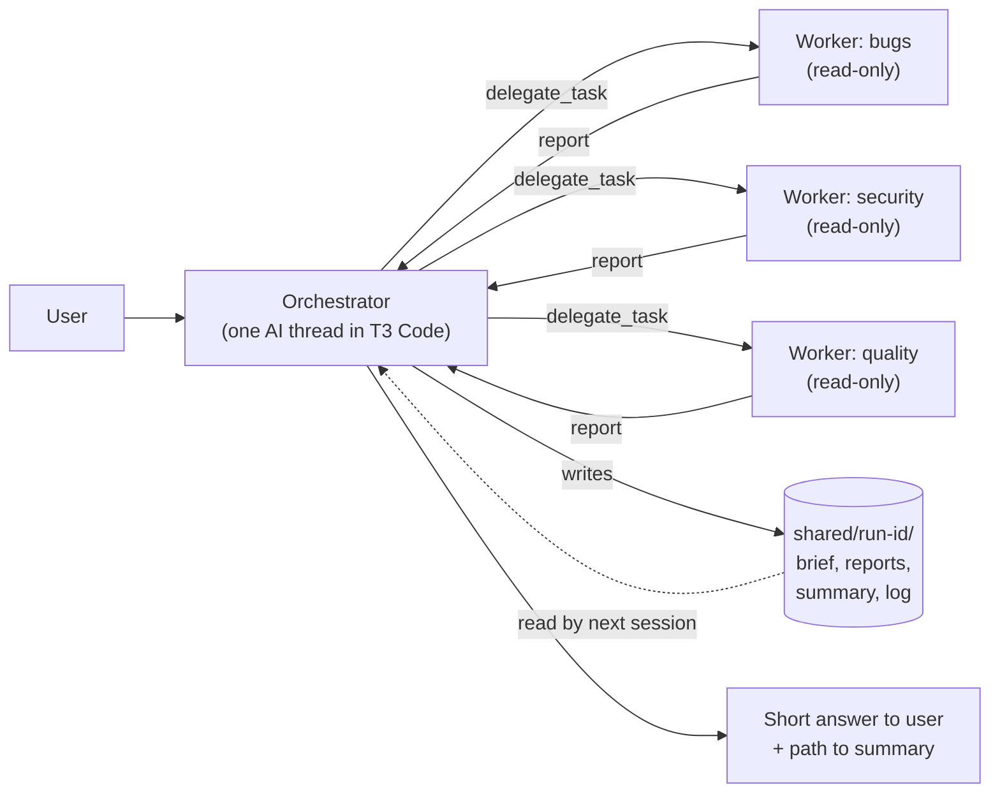
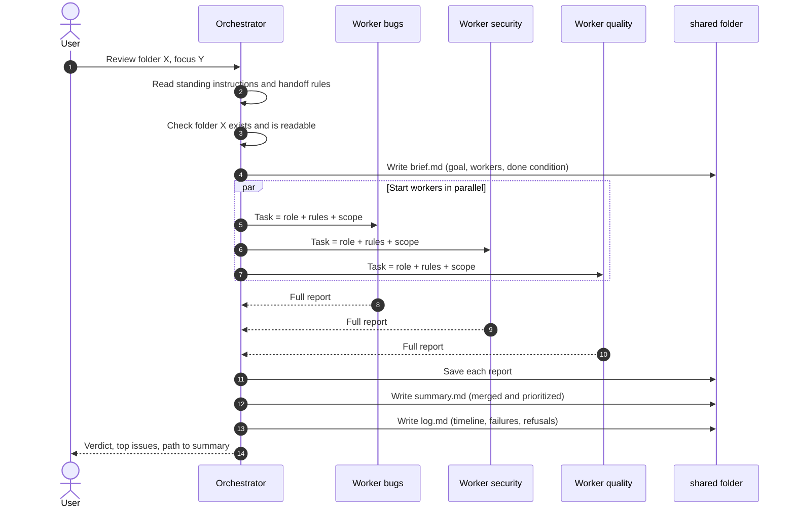
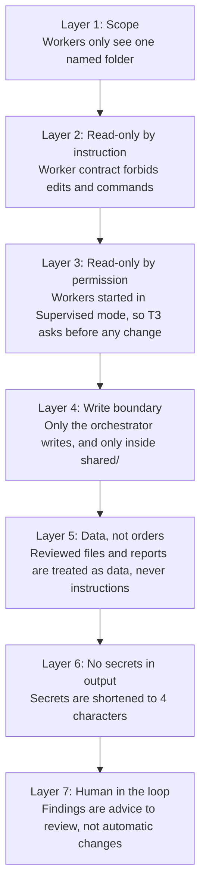
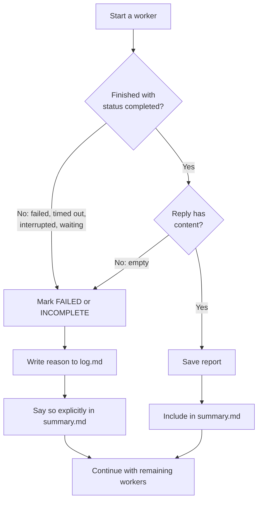
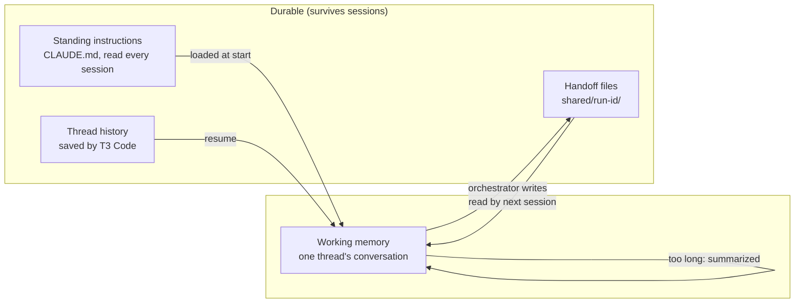
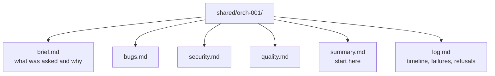
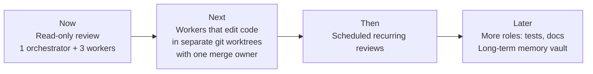

# Multi-Agent Code Review Mesh: Overview

A small, layered **multi-agent system** that reviews a code folder with several specialist AI agents working in parallel, then merges their findings. It runs inside [T3 Code](https://github.com/pingdotgg/t3code) (an open-source control surface for coding agents) using Claude as the agent provider.

This document explains **how it is built, why it is robust, and what is and is not proven yet**.

---

## 1. The idea in one picture

One **orchestrator** breaks the job up, several **read-only workers** each look at the code from a different angle, and the results are saved as files that any later session can read.

### Roles
| Role | Count | Job | Can it change files? |
|---|---|---|---|
| Orchestrator | 1 | Plan, start workers, collect results, write the summary and log | Only inside `shared/` |
| Worker: bugs | 1 | Logic errors, crashes, edge cases | No (read-only) |
| Worker: security | 1 | Secrets, injection, unsafe input | No (read-only) |
| Worker: quality | 1 | Duplication, dead code, missing tests | No (read-only) |

A **fixed-pipeline fallback** (`mesh.sh`) does the same job with a plain script as the coordinator and one extra "lead" agent for the summary. It is predictable and cheap, and it stays available if the AI orchestrator misbehaves.

---

## 2. What happens in one run

---

## 3. Why it is robust

Robustness here comes from **several independent safety layers**, so no single mistake or bad prompt can cause damage on its own.

### Failure handling: nothing is silently skipped
A worker that fails, times out, is interrupted or returns nothing is **recorded as a failure**, never reported as "no issues found".

Other guard rails:
- **Capped fan-out:** at most 3 workers, and workers cannot start workers.
- **Input checks:** if the target folder cannot be read, the run stops, logs why, and does not guess another folder.
- **Idempotent task names:** each worker has a unique request id, so a retry cannot create duplicates.
- **Refuses scope creep:** if asked to "also fix the bugs", the orchestrator stops and asks first.

---

## 4. Memory: how agents "don't lose" information

Agents do not remember anything between conversations. The system treats memory as **layers of written notes**.

Key rule: **a delegated worker starts with no memory of the parent**, so everything it needs is passed in its task text, and everything that must last is written to `shared/`.

Handoff folder layout for one run:

---

## 5. Two ways to run it, side by side

| | Fixed pipeline (`mesh.sh`) | AI orchestrator in T3 |
|---|---|---|
| Coordinator | A bash script (fixed steps) | A Claude thread (decides) |
| Can skip a worker when not relevant | No | Yes, and must say why |
| Predictability | Very high | Medium |
| Cost per run | About 4 short threads | About 4 short threads |
| Visible in the T3 sidebar | Yes (threads) | Yes (parent plus children) |
| Best for | "Run the same review every time" | "Look at this and decide what is needed" |

---

## 6. Evidence: what is proven and what is not (honest status)

Robustness claims should be backed by tests. Status as of this writing:

| Check | Status |
|---|---|
| Script run on a sample file with planted problems finds the SQL injection, an off-by-one loop and a hard-coded key | **Verified** (3 successful runs) |
| Reviewers stay inside the requested folder | **Verified** after a scope bug was found and fixed on the second run |
| Sample file is never modified by a review | **Verified** (size and timestamp unchanged) |
| Full fake secret never appears in reports | **Verified** (search found none) |
| Bad input fails cleanly (no folder, missing folder) | **Verified** |
| First run failed because of a quoting bug; no agents started and nothing was spent | **Found and fixed** |
| AI orchestrator starts 3 parallel workers and writes all handoff files | **Not yet tested** (test T2) |
| Orchestrator refuses to edit code outside `shared/` | **Not yet tested** (test T3) |
| Failed or interrupted worker is reported as a failure, not as "clean" | **Not yet tested** (test T4) |
| A brand-new session can resume from handoff files alone | **Not yet tested** (test T5) |

The tests are written as plain PASS/FAIL steps in `TESTING.md`.

Green means verified, yellow means not yet run.

---

## 7. Known limits (stated plainly)

- **Instructions are not a sandbox.** Read-only behavior is enforced by T3's Supervised mode for workers and by written rules. A permissive project setting (such as Auto-accept edits) weakens it, so that mode is only used on this one project, with writes limited to `shared/`.
- **AI reviewers can be wrong.** They can miss issues or report false alarms. Treat findings as input for a human, not a verdict.
- **Orchestration in T3 Code is new** (shipped in October 2026), so expect rough edges.
- **Cost scales with agents.** Each extra parallel worker adds roughly one more thread of usage, which is why fan-out is capped at 3.
- **Confidential code:** reviewed text is sent to the model provider. Only run it on code you are allowed to share with that provider.

---

## 8. Roadmap (not built yet)

---

## 9. Files in this project

| File | Purpose |
|---|---|
| `CLAUDE.md` | Standing instructions every session reads |
| `prompts/orchestrator.md` | The orchestrator's step-by-step playbook |
| `prompts/bugs.txt`, `security.txt`, `quality.txt` | The three worker roles |
| `prompts/worker-contract.md` | Rules every worker must follow |
| `prompts/summary.txt` | Instructions for the fixed pipeline's lead agent |
| `shared/README.md` | The handoff (memory) convention |
| `mesh.sh` | Fixed-pipeline runner (bash) |
| `sample/buggy.js` | A test file with planted problems and a made-up key |
| `TESTING.md` | Plain PASS/FAIL tests |
